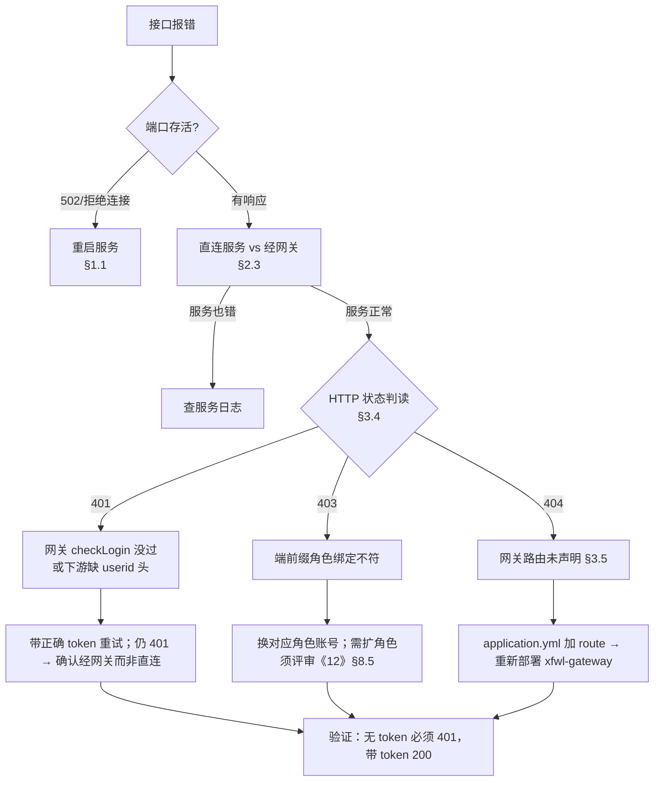

# 环境故障排障手册（网关 / 鉴权 / 菜单 / 配置）

> **日期**：2026-10-06
> **来源**：本日联调实战排障沉淀（网关 500、登录无菜单、配置丢失等）
> **用途**：开发/测试/运维遇到"接口报错但不知根因"时的**第一本排查手册**
> **价值**：把"报错信息 → 根因 → 处置"固化成表，避免每次重新试错

---

## 〇、先读这一段：排障纪律（血的教训）

本日报障中出现多次"**响应互相矛盾**"导致差点误判：

| 现象 | 真相 |
|---|---|
| `menu/router` 有时返回 `[]`、有时 `''`、有时"系统繁忙" | **服务在反复宕启/抖动** |
| 同一 URL 第一次 500、第二次 200 | 服务刚重启完 |
| `upstream connect failed os error 10061` | 目标进程**根本没在监听** |

### ✅ 三条铁律

1. **先探活，再分析**：任何"接口行为异常"的第一步是确认进程存活（见 §1.1），**不要一上来就读业务代码**。
2. **502/连接拒绝 ≠ 业务问题**：这说明是**基础设施层**，与代码逻辑无关。
3. **改了 Nacos 配置 ≠ 一定生效**：Redis/连接池类配置**必须重启进程**（Nacos 推送不重建连接池）；但普通配置项（如路由、白名单）**推送即生效**。

---

## 一、故障速查表（先看现象对号入座）

| 现象 / 报错 | 根因层 | 快速定位 | 处置 | 详见 |
|---|---|---|---|---|
| `401 {"code":401,"msg":"未登录或登录已过期，请重新登录"}` | 网关 `SaTokenConfigure` `checkLogin` 没过 | 看请求头是否带 `token`；token 是否过期 | 带正确 `token` 头 / 重新登录（有效期 7200s） | §3 |
| `403 {"code":403,"msg":"无权访问该端功能"}` | 端前缀角色绑定不符 | 确认账号角色码 vs `SaTokenConfigure` | 换对应角色账号 | §3.2 |
| `401 {"code":401,"msg":"未登录或身份信息缺失，请通过网关访问"}` | **下游** `TokenAuthInterceptor` 缺 `userid` 头 | 是否绕过网关直连了服务端口 | 一律经网关 `:8760` 访问 | §3.1 |
| `404` 网关路径 | 路由没有该前缀 / 服务未注册 Nacos | 查 `xfwl-gateway/application.yml` `routes` | 加显式路由（`StripPrefix=2`） | §3.4 §3.5 |
| `502` / `upstream connect failed` | **进程挂了** | `curl 直连该服务端口` | **重启服务**（§1.1） | §1.1 |
| 登录成功但**菜单为空** | 角色/授权链断（`sys_user_role`→`sys_role_menu`→`sys_menu`） | §4.2 三条 SQL | 补绑定；刷新页面即生效 | §4 |
| `{"code":-1,"msg":"系统繁忙~请稍后再试~"}` | 下游不可达 | 看网关日志 | 查下游服务是否存活 | §1.1 |
| 改 Nacos 后行为没变 | 配置未生效 | 区分配置类型（§2.2） | 路由类推送即生效；连接池类须重启 | §2.2 |
| Nacos 配置"消失" | 读了错误 group | 确认 `group=xinfei-tms` | 见索引·关键约束速记（namespace/group 坐标） | — |
| `code:0` 但数据为空 | 业务逻辑/缓存 | 查 Redis 缓存 key | 见 §4.2 | §4.2 |

---

## 二、排障工具箱（先会用工具）

### 2.1 服务存活探测（最高频，先跑这个）

```bash
# 单个服务
curl -s -o /dev/null -w "%{http_code}\n" --max-time 5 "http://192.168.20.130:9000/actuator/health"

# 批量（按项目实际端口改）
for p in 9000 8760 8161 8162 8163 8164 8185 8186 8187 8189 8190 8191 8192; do
  echo -n "$p -> "
  curl -s -o /dev/null -w "%{http_code}\n" --max-time 4 "http://192.168.20.130:$p/actuator/health"
done
```

**结果判读**：

| 返回 | 含义 |
|---|---|
| `200` | 健康 |
| `404` | **进程在**（该路径无此端点，正常现象） |
| `502` | 🔴 **进程或依赖故障** |
| 空/`000` | 🔴 **进程没在监听**（`os error 10061`） |

> ⚠️ **别把 404 当成故障**——项目大多没开放 `/actuator/health`，404 反而说明**端口活着**。

### 2.2 判断"改了配置生效没有"

| 配置类型 | 生效方式 | 验证 |
|---|---|---|
| 网关路由 `spring.cloud.gateway.routes` | 🔴 **需重启 `xfwl-gateway`**（写在 `xfwl-gateway/src/main/resources/application.yml`，改仓库版须随镜像发布） | 直接 curl 新前缀 |
| Sa-Token 鉴权规则（`SaTokenConfigure`） | 🔴 需重新构建部署网关（Java 代码，非配置） | 白名单路径免 token 应 200 |
| `sa-token.*`（timeout / token-name 等） | 🔴 需重启（客户端启动时装配） | 登录后看 token 有效期 |
| `spring.redis` / `spring.datasource` | 🔴 **必须重启**（连接池启动时装配） | 重启后看日志 |
| `sys_menu` / `sys_role_menu` 等库内权限数据 | ✅ **无需重启**，前端刷新页面即生效 | `GET /api/v1/menus/routes` |

### 2.3 直连绕过网关（定位"是网关的问题还是服务的问题"）

**这是最有用的一招**：

```bash
# 经网关（无 token 应 401 —— 401 说明网关在干活，不是服务挂了）
curl -s -o /dev/null -w "%{http_code}\n" "http://192.168.20.130:8760/api/v1/menus/routes"

# 直连服务（xfwl-auth:9000 / xfwl-web-manager:8161 / xfwl-netty:8192 …）
# ⚠️ 直连必然被 TokenAuthInterceptor 挡成 401（缺网关注入的 userid 头），
#    这是设计如此。要验服务本身健康，改探它的 actuator：
curl -s -o /dev/null -w "%{http_code}\n" "http://192.168.20.130:9000/actuator/health"
```

| 组合 | 结论 |
|---|---|
| 网关 500 + 直连 200 | **网关侧问题**（过滤器/配置）→ §3 |
| 网关 500 + 直连 500 | **服务自身问题** → 看服务日志 |
| 网关 502 + 直连 502 | **服务已挂** → §1.1 重启 |

---

## 三、网关鉴权体系（理解它才能正确排障）

> 🔴 **现行模型（2026-10-14 按源码核对）**：网关 = **Spring Cloud Gateway + Sa-Token**（`xfwl-gateway`，仅 4 个类：`GatewayApplication` / `CorsConfigure` / `SaTokenConfigure` / `ForwardSameTokenFilter`）。**没有** `AccessFilter`、**没有**资源清单表、**不用** j2cache——旧 pd-authority(Zuul) 那套"注册资源才放行"的关卡已随模块删除（定案 `D-61` ③）彻底不存在，排障时**不要**再找资源表。

### 3.1 请求链路

```
浏览器/H5  请求头 token: <sa-token 值>（头名是 token，不是 Authorization）
  ↓
xfwl-gateway:8760
  ├─ SaTokenConfigure（SaReactorFilter，addInclude /** ，addExclude /favicon.ico）
  │     ① OPTIONS 预检直接 return
  │     ② SaRouter.match("/api/auth/anno/**").stop()      ← 匿名白名单（验证码/登录）
  │     ③ SaRouter.match("/**", checkLogin())             ← 其余一律要求登录，否则 401
  │     ④ 按端前缀 checkRoleOr(...)                        ← 角色不符 403 NotRoleException
  └─ ForwardSameTokenFilter（GlobalFilter, order=-100）
        注入 Same-Token；已登录再注入 tenantId、userid 头
  ↓
下游 xfwl-web-* / xfwl-netty / xfwl-auth
  └─ TokenAuthInterceptor：缺 userid 头 → 401（防绕过网关直连）；
     /swagger /v2/api-docs /webjars /favicon.ico /error /actuator /csrf 前缀放行
```

> **定位口诀**：401 = 网关 `checkLogin` 没过 **或** 下游缺 `userid` 头；403 = 端前缀角色绑定没过；404 = 网关路由没配（路由真源在 Nacos `xfwl-gateway` 配置，不在仓库）。
> ⚠️ **网关自家探活坑**：`/actuator/health` 落在 ③ 的 `checkLogin()` 之内，容器 HTTP 探活会拿到 401——健康检查因此必须走 TCP 或给网关加匿名放行，勿误判成"服务挂了"。

### 3.2 现行三道关卡（源码逻辑）

真源：`xfwl-gateway/src/main/java/com/xinfei/gateway/config/SaTokenConfigure.java`、`filter/ForwardSameTokenFilter.java`、`xfwl-common/.../interceptor/TokenAuthInterceptor.java`。

```java
// 关卡1：登录态（SaTokenConfigure）
SaRouter.match("/api/auth/anno/**").stop();            // 匿名白名单，仅此一条
SaRouter.match("/**", r -> StpUtil.checkLogin());      // 其余一律 401

// 关卡2：端前缀角色绑定（同一 setAuth 内，checkLogin 之后）
SaRouter.match("/api/manager/**",     r -> StpUtil.checkRoleOr("ADMIN"));
SaRouter.match("/api/web-driver/**",  r -> StpUtil.checkRoleOr("ROLE_DRIVER", "ADMIN"));
SaRouter.match("/api/web-courier/**", r -> StpUtil.checkRoleOr("ROLE_COURIER", "ADMIN"));
SaRouter.match("/api/web-customer/**",r -> StpUtil.checkRoleOr("CUSTOMER", "ADMIN"));
SaRouter.match("/api/v1/**",          r -> StpUtil.checkRoleOr("ADMIN"));
// /api/auth/**（登录态相关）与 /api/netty-service/**（轨迹/告警四端共用）保持仅 checkLogin

// 关卡3：接口级权限码（子服务方法上的 @SaCheckPermission，由 xfwl-auth StpInterfaceImpl 供码：
//        sys_role_menu → sys_menu(type=B 的 perm)，ADMIN 角色直接 "*"）
```

> ⚠️ **重要特性**：关卡2/关卡3 **不是**"注册才放行"——没登记权限点的接口只要登录就 200。
> 所以"接口返回 200"**不等于**"鉴权生效"；判断细粒度权限是否工作，必须用**未绑该 perm 的角色 Token** 复测，
> 并对照代码：`grep -rn "@SaCheckPermission" <模块>/src`（命中 0 = 该模块权限尚未落地，属《08》A.3 缺口，不是 bug）。

### 3.3 鉴权相关请求头（排障必记）

| 头名 | 谁设置 | 用途 |
|---|---|---|
| `token` | **前端** | Sa-Token 令牌（`sa-token.token-name: token`，**不是 Authorization**） |
| `Same-Token` | **网关注入** | 子服务据此确认来自网关，堵住绕过网关直连 |
| `userid` / `tenantId` | **网关注入**（从 token-session 取） | `TokenAuthInterceptor` 兜底校验 + 下游租户/身份解析 |

- 有效期 **7200s（2 小时）**，`active-timeout: -1`（不限制临时有效期），`token-style: uuid`，**无 refreshToken** → 过期即 401，需重新登录。
- 会话落 **Redis**（`xfwl-gateway` / `xfwl-auth` / `xfwl-dispatch` 均引 `sa-token-redis-jackson`）。
- ⚠️ `StpInterfaceImpl` / `MenuService` **无进程内缓存**（xfwl-auth 全模块 0 处 `@Cacheable`/Caffeine）：改 `sys_menu`/`sys_role_menu` 后**不用重启服务**，前端**刷新页面**重取 `GET /api/v1/menus/routes` 即生效。旧的"必须重启 auth-server 清 L1"经验**已作废**（属 j2cache 时代）。

### 3.4 新增接口怎么才不被拒（现行做法）

网关按 `/api/<端>/**` **前缀**路由并鉴权，**没有逐接口注册这一层**。所以：

| 现象 | 真实原因 | 正确处置 |
|---|---|---|
| 404 | 网关路由（`xfwl-gateway/application.yml` `spring.cloud.gateway.routes`）没有该前缀，或子服务未注册到 Nacos | 加显式路由（含 `StripPrefix=2`）；确认服务名与 `lb://` 一致 |
| 401 | 未带 / 带错 `token` 头，或 token 过期；直连子服务端口缺 `userid` 头 | 经网关访问并带 `token` 头；重新登录 |
| 403 | 角色码与端前缀绑定不符（如司机 Token 调 `/api/manager/**`） | 换对应角色账号；或在 `SaTokenConfigure` 增补角色（需评审，属横切红线《12》§8.5） |
| 菜单/按钮不显示 | `sys_menu` 未登记该路由（`type=M`）或 `sys_role_menu` 未绑角色 | 补登记后**重新登录**验证 `GET /api/v1/menus/routes` |
| 接口能进但按钮该禁 | `@SaCheckPermission` 未挂 / `perm` 串与 `sys_menu` 不一致 | 两端字符串逐字比对（大小写与冒号分隔） |

### 3.5 网关路由速查（7 条，`xfwl-gateway/src/main/resources/application.yml`）

| 网关前缀 | 目标服务（`lb://`） | StripPrefix | 例 |
|---|---|---|---|
| `/api/auth/**` | xfwl-auth | 2 | `/api/auth/anno/login` → `/anno/login` |
| `/api/v1/**` | xfwl-auth | 2 | `/api/v1/menus/routes` → `/menus/routes` |
| `/api/manager/**` | xfwl-web-manager | 2 | `/api/manager/dashboard/overview` → `/dashboard/overview` |
| `/api/web-driver/**` | xfwl-web-driver | 2 | `/api/web-driver/user/profile` → `/user/profile` |
| `/api/web-courier/**` | xfwl-web-courier | 2 | — |
| `/api/web-customer/**` | xfwl-web-customer | 2 | — |
| `/api/netty-service/**` | xfwl-netty | 2 | `/api/netty-service/trace/latest` → `/trace/latest` |

> ⚠️ `discovery.locator.enabled: false` → **内部服务（xfwl-oms/xfwl-work/xfwl-base/xfwl-user/xfwl-dispatch/xfwl-aggregation）默认无路由**，新增网关暴露接口必须在 `routes` 显式加一条。
> 移动 H5 走 `/prod-api/web-*`（容器 nginx rewrite 成网关 `/api/web-*`）；App/小程序直连 `:8760/api/web-*`。

---

## 四、专项：登录成功但菜单为空

### 4.1 现行链路（xfwl-auth `/menus/routes`）

`GET /api/v1/menus/routes`（网关 StripPrefix=2 → xfwl-auth `/menus/routes`）
→ `StpInterfaceImpl.authorizedMenuIds(userId)`：`sys_user_role` → `sys_role`(status 有效) → `sys_role_menu` → `sys_menu`(status=1)。
**超管短路**：角色含 `ADMIN` 时返回 `null` = 不过滤、全量下发。

断链定位（按命中顺序）：

| 现象 | 原因 | 判据 |
|---|---|---|
| 401 | token 缺失/过期 | 见 §3.4 |
| 空数组、非 ADMIN 账号 | `sys_user_role` 没有该用户 → `roleIds` 空 → 直接返回空列表 | §4.2 第 1 条 SQL 返回 0 行 |
| 空数组、有角色 | `sys_role_menu` 未绑该角色，或绑的菜单 `status≠1` | §4.2 第 2 条 SQL 返回 0 |
| 部分菜单缺失 | `sys_menu` 该行 `status≠1`，或父目录未一起授权 | 逐项比对 `sys_menu` |

### 4.2 自查 SQL（现行单库 `xinfei_tms`）

```sql
-- ① 用户绑了哪些角色
SELECT r.id, r.code, r.name, r.status FROM xinfei_tms.sys_user_role ur
  JOIN xinfei_tms.sys_role r ON r.id = ur.role_id WHERE ur.user_id = <uid>;

-- ② 这些角色可见的菜单数（status=1 才算）
SELECT COUNT(*) FROM xinfei_tms.sys_role_menu rm
  JOIN xinfei_tms.sys_menu m ON m.id = rm.menu_id AND m.status = 1
  WHERE rm.role_id IN (<roleId 列表>);

-- ③ 直接看该用户能拿到的权限码（等价 StpInterfaceImpl 输出，ADMIN 为 "*"）
SELECT DISTINCT m.perm FROM xinfei_tms.sys_user_role ur
  JOIN xinfei_tms.sys_role_menu rm ON rm.role_id = ur.role_id
  JOIN xinfei_tms.sys_menu m ON m.id = rm.menu_id AND m.status = 1
  WHERE ur.user_id = <uid> AND m.perm IS NOT NULL AND m.perm <> '';
```

> 口令不写文档：取服务器 `.env`，或 `mysql -p` 交互输入。

### 4.3 生效条件（别再按 j2cache 时代的"重启"处置）

```bash
# 1. 改库（sys_menu / sys_role_menu）——先 §4.2 备份受影响行主键
# 2. 前端刷新页面重取路由（xfwl-auth 无 @Cacheable/Caffeine，实时查库）
curl -s -H "token: <token>" "http://192.168.20.130:8760/api/v1/menus/routes" | head -c 400
```

**不需要**重启 `xfwl-auth` / `xfwl-gateway`、**不需要**清 Redis 菜单 key：`user_menu:*`、`resource:resource_need_to_check`、`user_resource:{userId}` 与 caffeine `menu/user_menu` TTL 全是旧 pd-authority(j2cache) 产物，新栈 0 处引用；Sa-Token 在 Redis 只存登录会话（`sa-token` 前缀），不含权限快照。

---

## 五、历史案例：配置项引用不存在的文件导致网关全挂

> 旧 pd-authority 网关曾因 `j2cache.config-location` 指向不存在的 properties → 初始化失败 → 所有走鉴权的接口 `500 pre:AccessFilter`。**该机制已整体删除**（pom 无 j2cache 依赖、仓库无 `j2cache.properties`）。可迁移的只有下面的**发现方法**——现行同类故障形态是 Nacos 配置项引用了不存在的文件或占位符没注入环境变量（如 `REDIS_PASSWORD`）。

### 5.1 怎么发现这类问题

```bash
# ① 直读 Nacos 配置正文（Nacos 已开鉴权，返回 403 "user not found!" 时先取 accessToken：
#    curl -s -d "username=<u>&password=<p>" http://192.168.20.130:8848/nacos/v1/auth/login）
curl -s "http://192.168.20.130:8848/nacos/v1/cs/configs?dataId=<配置名>&group=xinfei-tms&tenant=<命名空间>" \
  | grep -nE "classpath:|config-location|\$\{[A-Z_]+(:.*)?\}"

# ② 再在仓库核对它引用的文件/占位符是否真的存在（现网已无 j2cache，按实际文件名替换）
find . -path ./node_modules -prune -o -name "<它引用的文件名>" -print
```

> 🎯 **通用原则**：Nacos 配置里凡指向 `classpath:` 的文件，都要确认它真实存在。

---

## 六、Nacos 配置排障

### 6.1 三层坐标（搞懂就不会乱）

配置唯一确定于：**命名空间(namespace) + 分组(group) + 配置名(dataId)**。

| 项 | 本项目值 |
|---|---|
| 命名空间 | `1cb93ce4-dc0e-4730-b759-d35fd7ed93c3` |
| **在用分组** | **`xinfei-tms`**（所有服务显式指定） |
| `DEFAULT_GROUP` | **不要清理**：本命名空间现存 27 条 = `xinfei-tms` 23 + `DEFAULT_GROUP` 3（`common.yml`/`redis.yml`/`mysql.yml` 的历史副本）+ `SEATA_GROUP` 1（`service.vgroupMapping.xinfei-tms-group`）。另：Seata 的 TC **必须**注册在 `DEFAULT_GROUP`（客户端 1.2.0 查询 group 固定），与这里的配置副本是两回事。清理前基线是 35 条，见《部署文档》§2.1、§五 |

### 6.2 text vs yaml 不是问题

Nacos 配置的 `type` **只影响控制台语法高亮**，客户端按 **dataId 后缀**决定解析器。`.yml` 后缀 → SnakeYAML 解析，与 `type` 无关。

### 6.3 读取配置的两种姿势

```bash
# ① 经网关（受鉴权保护，必须带 token 头；不带 → 401）
curl -s "http://192.168.20.130:8760/api/v1/menus/routes" -H "token: <登录返回的 token>"

# ② 直连 Nacos（排障首选，不受网关影响）
curl -s "http://192.168.20.130:8848/nacos/v1/cs/configs?dataId=xfwl-gateway.yml&group=xinfei-tms&tenant=1cb93ce4-dc0e-4730-b759-d35fd7ed93c3"
```

---

## 七、常见错误速查（踩过的坑）

| 错误做法 | 正确做法 | 后果 |
|---|---|---|
| 直连 `xfwl-web-*` 8161~8164 调试 | 一律经网关 `:8760/api` | 缺 `userid` 头 → **401** |
| 用 `Authorization` 头传 JWT | 用 **`token`** 头 | 401 |
| 写 `POST /xxx` 提交到 `@PutMapping` | 以接口文档为准（注意 GET/POST/PUT 区分） | 405/404 |
| 前端 URL 直接写 `xfwl-oms /pay/*` | 内部 Feign 服务**网关无路由** | **404** |
| Nacos 改 `spring.redis` 后只等推送 | **必须重启进程** | 配置不生效 |
| 用 `userId <= 0` 判断 String 判空 | 用 `StrUtil.isBlank()` | **NumberFormatException** |
| 服务 502 时还在读业务代码找原因 | **先探活**（§1.1） | 浪费时间、得出错误结论 |
| 改菜单/权限数据后去清 Redis key 或重启服务 | 现行 `StpInterfaceImpl` 无缓存，前端**刷新页面**即可 | 白折腾、还误判"改了不生效" |
| 新接口"没注册资源表"所以 401 | **没有资源表关卡**，网关只按端前缀鉴权 | 找错方向、白白插数据 |
| 实体字段用 `LIKE '%{col}%'` 查缺列 | MySQL 里 `{}` 是多字符通配，须用 `LOCATE('{',url)>0` | 误判 0 行、修复不生效 |
| 枚举字段直接映射 int 列（无 TypeHandler） | MyBatis 默认存**枚举名**，int 列会报 `Incorrect integer value` | 查询报「运行SQL出现异常」 |
| 接口报「系统繁忙」时只怀疑数据问题 | 先查**实体映射的表是否存在**（`@TableName`） | 表不存在，接口直接异常 |
| 清理"脏授权"联表 `DELETE` 不加类型限定 | 多态关联表**必须**加类型列限定 | 曾把 MENU 授权连带删掉，后台菜单全空 |
| 改权限数据后等 TTL / 重启容器 | 现行无进程内缓存，刷新页面即生效（§4.3） | 白等两小时 |

---

## 七之二、实体与表结构不匹配（2026-10-07 实测两类）

**症状**：接口返回 `{"code":-1,"msg":"系统繁忙~请稍后再试~"}` 或 `运行SQL出现异常`，但网关与鉴权都正常。

**排查命令**：
```bash
# 1. 拿实体的 @TableName 值，去 xinfei_tms 单库确认表存在
# 2. 比对列：实体 @TableField 列vs information_schema.COLUMNS
# 口令不写在命令/文档里，取服务器 .env（也可交互式用 -p 不带值，回车后手输）
DB_PASS=$(sed -n 's/^MYSQL_ROOT_PASSWORD=//p' /data/deploy/middleware/.env)
mysql -h 192.168.20.130 -uroot -p"$DB_PASS" -N -e "
SELECT COLUMN_NAME FROM information_schema.COLUMNS
WHERE TABLE_SCHEMA='xinfei_tms' AND TABLE_NAME='sys_role';"
```

**已发生过的实例（2026-10-07 旧栈；下列机制在单库重构后已不复现，方法仍照用）**：

| 实例 | 现象 | 根因 | 修法 |
|---|---|---|---|
| 角色表缺 `ds_type` | 角色相关接口全报系统繁忙 | 实体 `Role` 有 `@TableField("ds_type")` + `@NotNull`，表里没这列（**建库脚本里也从没定义过**） | 补列。⚠️ 若补成 `int`仍报错，见下一行 |
| `ds_type` 类型不匹配 | 补列后仍报错 | `DataScopeType implements BaseEnum` 但接口**无 `getValue()`**，MyBatis 默认 `EnumTypeHandler` 存**枚举名** `'ALL'` → int 列报 `Incorrect integer value: 'ALL'` | 改列类型为 `varchar(20)`，回填 `'ALL'` |
| 缺区划表 | `/area/{id}`、`/area/code/{code}` 报系统繁忙 | 实体 `Area` 的 `@TableName` 与库里实际表名不一致，接口直接抛异常 | 现行口径：实体 `Area` → `@TableName("dict_area")`（`xfwl-auth/src/main/java/com/xinfei/auth/entity/Area.java:16`），表就在 `xinfei_tms`，无需再跨库 `CREATE TABLE ... LIKE` |

---

## 八、标准排障流程（照做即可）



**文字版**：
1. **探活** —— 端口还在吗？（§1.1）
2. **对比** —— 直连服务 vs 经网关，谁错？（§2.3）
3. **定位** —— 按 HTTP 状态落到 §3.4 表（401 鉴权 / 403 角色 / 404 路由）
4. **查配置** —— Nacos / 镜像环境变量里是否有指向不存在文件或未注入的占位符（§5.1）
5. **改权限数据** —— 刷新页面验证 `GET /api/v1/menus/routes`，**不需要**清缓存或重启（§4.3）
6. **验证鉴权真在工作** —— 无 token 调受保护接口必须 401；**拿到 200 不等于放行正确**（§3.2）

---

## 九、本日实战案例（供复盘参考）

| 时间 | 现象 | 真根因 | 教训 |
|---|---|---|---|
| 14:33 | 浏览器 4 条报错 | `/gate/dictionary/enums` 404 + 网关 500 | 前端遗留旧路径 + j2cache 配置错 |
| 15:57 | 接口仍 500 | **j2cache 指向不存在文件** | 不是"重启"能解决，配置本身错 |
| 16:11 | 配置太多看晕 | `DEFAULT_GROUP` 17 条死配置 | 命名空间+group+dataId 三层坐标 |
| 16:20 | 登录成功没菜单 | auth-server 宕机 + userId 为 null | **先探活**再读代码 |
| 16:44 | 响应互相矛盾 | 服务在反复重启 | 矛盾结果 = 基础设施问题 |

---

> **一句话总结**：**报错信息 → 探活 → 直连对比 → 按 HTTP 状态定位（401 鉴权 / 403 角色 / 404 路由）→ 查配置**。绝大多数"接口不工作"都能在这 5 步内定位；其中 **502 优先探活重启、401/403/404 一律先回 §3.4 对号入座、菜单空先跑 §4.2 三条 SQL**，不要再找资源清单表或 j2cache。

