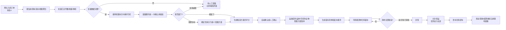
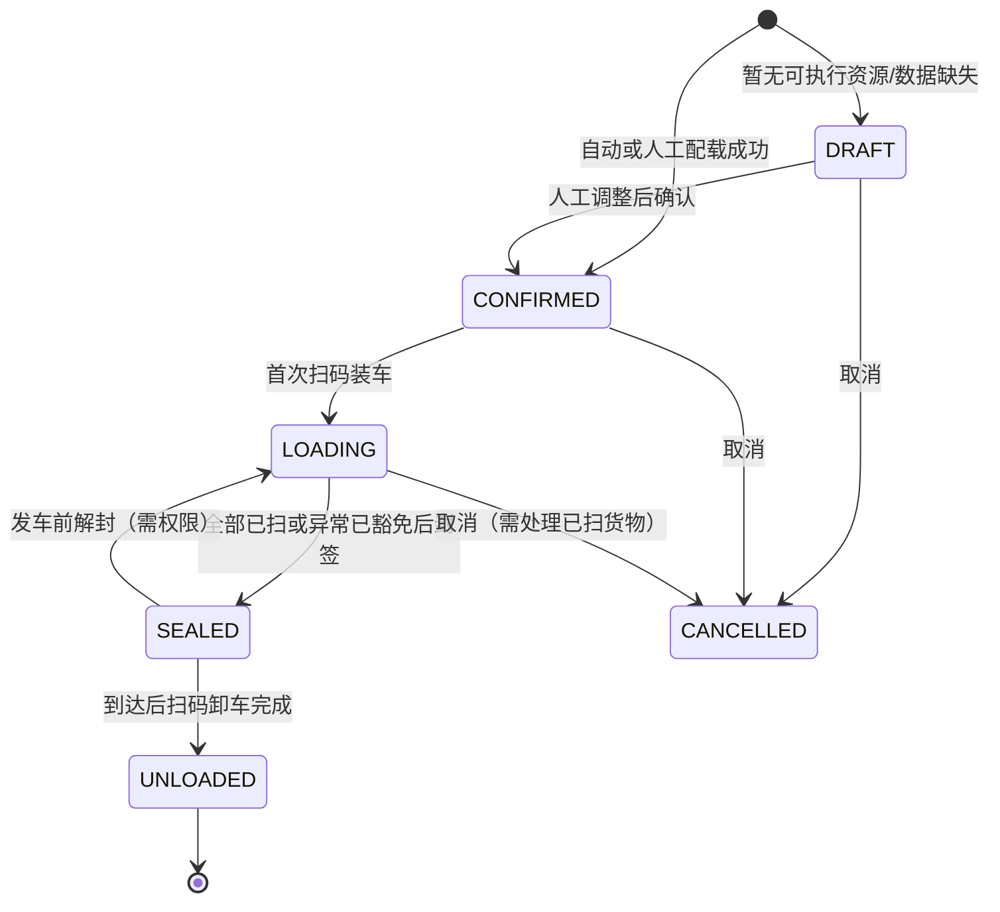

# 77-零担 TMS 智能调度、配载、装车闭环修复任务卡（Claude Code）

> 项目：心飞物流 TMS（原品达 TMS，仓库包名已切换为 `com.xinfei`，模块前缀 `xfwl-*`）  
> 日期：2026-10-24  
> 交付对象：Claude Code / 后端 / Vue3 管理端 / uni-app 司机端  
> 任务类型：P0 业务闭环修复 + P1/P2 演进规划  
> 核心目标：把当前“线路规划 + 固定车次匹配”补齐为“货量聚合 → 容量约束配载 → 方案确认 → 装车清单 → PDA 扫码/封签 → 发运/到车核验 → 状态回写”的零担干线闭环。

---

## 0. 给 Claude Code 的执行指令

1. **先做 P0，不允许直接上复杂求解器、3D 装箱、机器学习。** P0 使用确定性规则引擎、容量硬约束和扫码状态机，先保证“不超载、不漏装、可追踪、可人工兜底”。
2. 本任务涉及多个微服务，**不要假设分布式大事务**。跨 OMS / WORK / BASE 的写操作采用：
   - WORK 本地事务保证运输单、运输任务、关联表、配载方案、司机作业单一致；
   - OMS 状态回写失败时必须调用 WORK 补偿取消/异常，不允许静默成功。
3. 所有 Feign 关键结果必须判空：
   - 读不到货量、车辆、车型、司机信息时，**按不可自动配载处理**；
   - 写运输任务/方案返回 `null` 时，必须失败或补偿，不允许返回成功。
4. 不允许使用 H2；迁移脚本必须按 MySQL 8 编写并在 Docker/本地 MySQL 8 实测。
5. 所有新表必须包含 `tenant_id`、`create_by/create_time/update_by/update_time/deleted`（追加型事件表除外），依赖 MyBatis-Plus 多租户插件，不硬编码租户 ID。
6. BFF 与移动端对外 ID 一律使用字符串；服务内部使用 Long，边界处显式转换，避免雪花 ID 超过 JS 安全整数。
7. 保留当前路线规划 DFS 的职责：它解决“走哪条线路/经过哪些机构”；本任务新增的是“某车装哪些货、能否装下、按什么清单装、如何核验”。
8. 不允许只在前端做载重/体积提示。容量约束必须在后端 WORK 确认方案时再次强校验。
9. 新页面必须接真实接口，不允许 mock 占位；README 截图后续必须来自 192.168.20.130 真实环境。
10. 建议按本文第 9 节拆小提交，每一批都能编译、迁移、启动、回归。

---

## 1. 一句话结论

当前心飞物流的调度链路已经能完成**订单分类、线路 DFS 规划、运输任务创建、车次/车辆/司机基础匹配**，但它还不是零担物流的“智能配载/装车系统”：

- 分类只按 `startOrgId#endOrgId#currentOrgId` 分组，没有汇总重量、体积、件数、时效；
- 车次匹配只取线路的第一组车次，再按发车时间选一台车，没有载重/体积约束；
- 没有候选方案评分、多车拆分、回程/顺路资源、车辆占用校验；
- 运输任务的装载状态被固定写为半载，缺少真实装载率；
- 没有配载方案、装车清单、装车顺序、月台/装车口、扫码事件、封签核验；
- 司机端扫码页目前只是占位，司机“提货/发运”时批量把运单改成已装车，无法防止漏装、错装。

P0 应先用**规则引擎 + 确定性装箱/拆单 + 扫码封签状态机**补齐闭环；P1 再接入包裹级条码/DWS、月台波次和 3D 装箱；P2 再做预测与学习型优化。

---

## 2. 当前仓库已确认现状

### 2.1 现有自动调度主链路

入口：`xfwl-dispatch/src/main/java/com/xinfei/task/DispatchTask.java`

当前顺序：

1. `TaskOrderClassifyServiceImpl`：订单分类；
2. `TaskRoutePlanningServiceImpl`：基于 `base_transport_line` 做 DFS 路线规划；
3. `BusinessOperationServiceImpl#createTransportOrderTask`：先创建运输任务和运单关联；
4. `TaskTripsSchedulingServiceImpl`：匹配车次、车辆、司机；
5. `BusinessOperationServiceImpl#operation`：回写运输任务，创建司机作业单，未匹配成功的任务标记为待人工分配。

### 2.2 已确认缺口矩阵

| 环节 | 当前实现 | 文件/表 | 缺口 |
|---|---|---|---|
| 订单分类 | `OrderClassifyDTO#groupBy()` 只拼接起始机构、目的机构、当前机构 | `xfwl-dispatch/.../DTO/OrderClassifyDTO.java` | 未使用货型、重量、体积、件数、时效、特殊货物属性，无法形成配载货量池 |
| 分类结果 | `disp_order_classify` 只有订单数 `total` | `sql/dispatch/05_disp.sql` | 没有总重量、总体积、件数、容量利用率、异常原因 |
| 路线规划 | 对线路做 DFS，支持距离/成本/用时/中转次数策略 | `TaskRoutePlanningServiceImpl.java` | 解决路径，不解决某台车装哪些货、能否装下、怎么装车 |
| 车次匹配 | `transportTripsDtos.get(0)` 取第一组车次，再按最近发车时间选择 | `TaskTripsSchedulingServiceImpl.java` | 未枚举全部车次/车辆，不做候选评分；货量超过一台车不会自动拆多车 |
| 车辆容量 | 仅过滤车辆 `status=1` 和 GPS 在线 | `TaskTripsSchedulingServiceImpl.java` | 未对比 `TruckDto.allowableLoad/allowableVolume`，存在超载/超容风险 |
| 车型尺寸 | 尺寸字段在车型表 | `base_truck_type.measure_long/width/high`、`TruckTypeDto` | `TruckDto` 未暴露车厢尺寸，调度没有批量装配车型快照 |
| 车辆占用 | 只看车辆/司机状态和 GPS 心跳 | `TaskTripsSchedulingServiceImpl.java` | 同一调度批次中多个货量组可能重复分配同一台车，也未系统检查未完成任务占用 |
| 运输任务创建 | 每个线路段创建一个 `work_task_transport` | `BusinessOperationServiceImpl.java` | 先建任务后找车；找不到车时留下待人工任务，没有方案版本/候选原因 |
| 装载状态 | 自动任务固定设置 `HALF` | `BusinessOperationServiceImpl#createTransportOrderTask` | 没有真实装载率；满载/半载/空载不可信 |
| 状态口径 | 枚举为 `1 空载、2 半载、3 满载` | `TransportTaskLoadingStatus.java` | `TaskTransportDTO`、`sql/work/06_work.sql`、部分 VO 注释仍写“1半载、2满载、3空载”，必须统一 |
| 运单与任务关系 | 只有关联表 | `work_transport_order_task` | 没有装车顺序、笼车/月台、扫码状态、件数核验、异常说明 |
| 手动派单 | 前端有载重/体积提示，后端只校验车辆存在 | `DispatchBoardController#assign`、`views/dispatch/index.vue` | 后端没有容量硬校验，可绕过前端直接提交超载方案 |
| 司机发运 | 司机“提货”时批量把运单状态改为已装车 | `xfwl-web-driver/.../CargoController.java#pickUp` | 未扫码也可发运，无法防止漏装/错装 |
| 司机扫码 | 扫码页只展示扫码内容并提示“功能待后端开通” | `xfwl-mobile/driver/src/pages/driver/task/scan.vue` | 没有装车清单、扫码、卸车、封签、异常处理 |
| 货物模型 | 只有订单聚合货物 | `oms_order_cargo`、`OrderCargoDto` | 没有包裹级长宽高、条码、是否可堆压、易碎、异形等字段 |
| 波次/月台 | 无相关表 | WORK/BASE SQL | 没有波次、月台、装车口、笼车、装车位、封签、扫码事件模型 |

### 2.3 现状边界

- 已有的是“运输任务/线路/车次”骨架，不是空白项目；P0 必须复用现有运输任务、司机作业单、运单状态流转，不另起一套运输域。
- 当前没有独立场站 PDA 端。P0 先在司机端 uni-app 完成装车/卸车/封签扫码；P1 再评估独立场站 PDA 角色。
- 当前没有 DWS 硬件对接。P0 的重量/体积来自订单申报值，不能宣称实测称重；P1 再接 DWS。

---

## 3. 联云公开方案分析（只采用可核验事实）

### 3.1 公开资料说明了什么

来源：

- TMS：<https://www.gzlcloud.com/products/tms/>
- LMS：<https://www.gzlcloud.com/products/lms/>
- 红之圆案例：<https://www.gzlcloud.com/cases/hongzhiyuan/>

公开资料可确认的能力：

1. **TMS 智能配载/派车**
   - 按货物体积、重量、目的地、时效要求匹配车型与路线；
   - 生成配载方案；
   - 调度员一键派车，司机 APP 接单；
   - 司机 APP 上报取货、装货、在途、卸货、交车等节点；
   - GPS 轨迹和回单结算形成闭环。

2. **LMS 场站作业**
   - DWS 自动称重量方，官网称单件处理约 1–2 秒；
   - 自动打印面单、自动分拣，官网称单通道约 800–1200 件/小时；
   - 按线路、车型、波次编排装车站位和装载顺序；
   - 装车时校验件数与运单一致性；
   - 发运前完成装车核验、装载清单、异常件和封签确认。

3. **PDA 执行闭环**
   - 红之圆案例公开说明 PDA 支持揽件、打单、称重、装车、卸车、派送、签收。

### 3.2 不能照搬或臆测的内容

- 官网没有公开它使用 OR-Tools、OptaPlanner、3D 装柜算法、机器学习模型等技术细节；本报告不得把这些写成联云已实现事实。
- 官网宣传的效率提升比例不能作为心飞物流的验收承诺，只能作为业务方向参考。
- 心飞物流 P0 不需要一开始复制 LMS 的自动化设备和波次月台；应先完成规则配载、容量约束、装车清单和扫码核验。

### 3.3 对心飞物流的启发

联云方案的本质不是“一个黑盒 AI 算法”，而是四层闭环：

1. **数据准**：订单货物的重量、体积、件数、目的地、时效进入系统；
2. **规则算**：按线路、车型、容量、波次和资源排班生成方案；
3. **现场核**：PDA/DWS 按清单扫码装车、核验件数、封签发运；
4. **结果回写**：发运、到车、签收、回单、结算反哺运输状态和经营分析。

---

## 4. P0 目标业务流程



### 4.1 P0 必须达成的结果

- 同一线路段的待配载订单自动汇总件数、重量、体积；
- 候选车辆必须同时满足载重、体积、车辆状态、司机状态、GPS 在线、车辆占用条件；
- 一台车装不下时，自动拆分为多个配载方案；无法拆分时进入待人工；
- 每个运输任务有且只有一个有效配载方案；
- 每个配载方案有装车清单、装车顺序、计划/已扫件数、计划/已扫重量体积；
- 未完成扫码或未处理异常时不能封签；未封签不能发运；
- 发运后任务状态、运单状态、订单状态、司机作业单状态保持一致；
- 管理端可以查看装载率、缺载/超载原因、扫码进度和异常件；
- 司机端可以扫码装车、封签、扫码卸车、上报异常。

### 4.2 P0 明确不做

- 不做 AI 黑盒自动决策；
- 不做真正 3D 空间摆放图；
- 不做 DWS 硬件直连；
- 不做自动分拣机、传送带、装车口硬件调度；
- 不做复杂网络流/多式联运优化；
- 不做包裹级逐件条码体系（P1）；
- 不做机器学习预测发车时间和货量（P2）。

---

## 5. P0 规则引擎设计

### 5.1 输入模型

#### 货量项 `LoadCargoItem`

建议放在 `xfwl-common/src/main/java/com/xinfei/common/loadplan/model/`：

| 字段 | 类型 | 说明 |
|---|---|---|
| `orderId` | String | OMS 订单 ID |
| `transportOrderId` | String | 已存在运单 ID 时传入；自动确认可由 WORK 创建 |
| `currentOrgId` | Long | 当前所在机构 |
| `startOrgId` | Long | 起始机构 |
| `endOrgId` | Long | 目的机构 |
| `transportLineId` | Long | 规划出的线路段 ID |
| `quantity` | Integer | 申报件数 |
| `weight` | BigDecimal | 申报总重量 kg |
| `volume` | BigDecimal | 申报总体积 m³ |
| `goodsTypeId` | String | 货型 ID，P0 只做保留/特殊提示 |
| `estimatedArrivalTime` | LocalDateTime | 预计到达/时效，用于排序 |
| `priority` | Integer | 优先级，可由时效和订单状态计算 |

#### 车辆候选 `LoadVehicleCandidate`

| 字段 | 说明 |
|---|---|
| `tripsId` | 车次 ID |
| `truckId` | 车辆 ID |
| `truckTypeId` | 车型 ID |
| `driverId` | 司机 ID |
| `transportLineId` | 线路 ID |
| `departureTime` | 车次发车时间 |
| `allowableLoad` | 准载重量 kg |
| `allowableVolume` | 准载体积 m³ |
| `measureLong/Width/High` | 车厢尺寸，P0 仅展示和预留，P1 做 3D |
| `truckStatus` | 车辆状态 |
| `onlineStatus` | GPS 在线状态 |
| `driverStatus` | 司机状态 |
| `occupied` | 是否存在未完成任务/本批次已预留 |

### 5.2 硬约束

配置项放入动态配置，给默认值：

| 配置键 | 默认值 | 说明 |
|---|---:|---|
| `dispatch.load.weight-safety-factor` | `0.98` | 重量安全系数，申报重量不得超过准载重量 × 系数 |
| `dispatch.load.volume-fill-factor` | `0.85` | 零担异形货可装载体积系数，预留 15% 操作空间 |
| `dispatch.load.full-threshold-percent` | `90` | 重量或体积利用率达到该值显示满载 |
| `dispatch.load.min-departure-lead-minutes` | `30` | 确认配载时距计划发车的最小准备时间 |
| `dispatch.load.auto-confirm` | `true` | 自动调度中是否自动确认可行方案 |

硬约束：

1. `plannedWeight <= allowableLoad * 0.98`；
2. `plannedVolume <= allowableVolume * 0.85`；
3. 车辆 `status=1`；
4. 车辆 GPS 在线，沿用现有离线禁排班逻辑；
5. 司机状态正常；
6. 车次绑定有效车辆和司机；
7. 车辆不存在未完成的运输任务，且本批次未被其他货量组预留；
8. 距离发车时间不少于配置的准备时间；
9. 货量件数、重量、体积必须为非空非负值；否则不能自动配载。

### 5.3 确定性装箱/拆分算法

P0 只在**同一当前机构、同一路线段、同一目的方向**内拼车，不做跨目的地复杂混装。

算法：

1. 按路线规划结果得到货量组；
2. 对货量组内订单排序：
   - 时效优先（预计到达时间早、待发车时间近）；
   - 大件优先（体积、重量较大者先放）；
   - 同优先级按订单 ID 稳定排序；
3. 枚举该车次线路下所有车辆/司机候选，不再只取第一组车次；
4. 对候选车辆做硬约束过滤并标记原因；
5. 使用 First Fit Decreasing：
   - 按排序结果逐票放入第一个还能容纳的候选车；
   - 若当前车辆放不下，尝试下一台；
   - 若一个订单单票超过所有车辆容量，输出 `OVERSIZE_SINGLE_ORDER`，进入待人工；
6. 同一调度批次内，已分配车辆加入 `reservedTruckIds`，防止重复占用；
7. 对可行方案排序：
   - 优先选择能装下且准载容量最小的车辆，避免大马拉小车；
   - 再比较重量/体积利用率，优先接近 90% 但不超载；
   - 再比较计划发车时间，优先满足时效且留出装车准备时间；
   - 最后按车辆 ID 稳定排序；
8. 自动任务只确认可行方案；缺车、缺司机、超载、数据缺失都生成待人工原因。

### 5.4 异常原因码

| 原因码 | 含义 | 前端展示 |
|---|---|---|
| `MISSING_CARGO_MEASURE` | 货物件数/重量/体积缺失 | 补录货量后重新配载 |
| `OVERLOAD_WEIGHT` | 超重 | 换大车或拆车 |
| `OVERLOAD_VOLUME` | 超容 | 换大车或拆车 |
| `OVERSIZE_SINGLE_ORDER` | 单票超过任何车辆 | 人工安排整车/异形车 |
| `TRUCK_DISABLED` | 车辆停用 | 更换车辆 |
| `OFFLINE_TRUCK` | GPS 离线 | 检查设备或更换车辆 |
| `DRIVER_UNAVAILABLE` | 无可用司机 | 调整司机排班 |
| `TRUCK_OCCUPIED` | 车辆已有未完成任务/本批次预留 | 更换车辆或调整发车时间 |
| `NO_TRIP_BINDING` | 车次未绑定车辆/司机 | 维护车次资源 |
| `DEPARTURE_TOO_SOON` | 距发车时间不足 | 更换车次或人工加急 |
| `NO_FEASIBLE_VEHICLE` | 无可行车辆 | 待人工配载 |

### 5.5 装载率与装载状态

统一枚举：

- `1 EMPTY 空载`；
- `2 HALF 半载`；
- `3 FULL 满载`。

计算：

```text
weightUtilization = plannedWeight / allowableLoad * 100
volumeUtilization = plannedVolume / allowableVolume * 100
maxUtilization = max(weightUtilization, volumeUtilization)

maxUtilization = 0       => EMPTY
0 < maxUtilization < 90  => HALF
maxUtilization >= 90     => FULL
```

注意：

- 硬约束按安全系数/填充系数；展示利用率按原始准载重量/体积计算；
- 已扫码值 P0 默认为申报值或人工录入值，不代表 DWS 实测值；
- 任何确认方案不得出现超载状态；超载只能是异常原因，不能作为已确认方案。

---

## 6. 配载方案状态机

### 6.1 方案状态

新增 `LoadPlanStatus`：

| 值 | 状态 | 含义 |
---:|---|---|
| 1 | `DRAFT` | 待人工/缺资源/缺货量数据 |
| 2 | `CONFIRMED` | 已确认车次、车辆、司机和清单，待装车 |
| 3 | `LOADING` | 已发生扫码装车 |
| 4 | `SEALED` | 已完成封签，允许发运 |
| 5 | `UNLOADED` | 已完成卸车核验 |
| 6 | `CANCELLED` | 已取消 |

### 6.2 扫码状态

新增 `LoadScanStatus`：

| 值 | 装车/卸车状态 |
---:|---|
| 0 | 待处理 |
| 1 | 已扫码 |
| 2 | 异常 |
| 3 | 人工豁免 |

### 6.3 状态流转



### 6.4 发运门禁

修改司机端现有“提货/发运”接口：

1. 新任务必须存在 `CONFIRMED/LOADING/SEALED/UNLOADED` 方案；
2. 从待执行进入在途前，方案必须为 `SEALED`；
3. 封签条件：
   - 所有清单运单为已扫码或人工豁免；
   - 人工豁免必须填写异常原因；
   - 不存在未处理的失败扫码/错装事件；
4. 未封签时调用发运接口返回 400：`请先完成装车核验并封签`；
5. 历史无方案任务可通过临时配置 `legacy.load-plan.departure.allow=true` 放行，迁移稳定后删除该开关。

---

## 7. 数据库改造

新增迁移脚本：

`sql/work/V20261024_1000__load_plan.sql`

### 7.1 扩展运输任务表

```sql
-- 配载方案与装载率字段
ALTER TABLE `work_task_transport`
  ADD COLUMN `plan_id` BIGINT UNSIGNED DEFAULT NULL COMMENT '配载方案ID work_load_plan.id' AFTER `loading_status`,
  ADD COLUMN `planned_quantity` INT NOT NULL DEFAULT 0 COMMENT '计划件数' AFTER `plan_id`,
  ADD COLUMN `planned_weight` DECIMAL(10,3) NOT NULL DEFAULT 0.000 COMMENT '计划总重量(kg)' AFTER `planned_quantity`,
  ADD COLUMN `planned_volume` DECIMAL(10,4) NOT NULL DEFAULT 0.0000 COMMENT '计划总体积(m³)' AFTER `planned_weight`,
  ADD COLUMN `loaded_quantity` INT NOT NULL DEFAULT 0 COMMENT '已扫件数' AFTER `planned_volume`,
  ADD COLUMN `loaded_weight` DECIMAL(10,3) NOT NULL DEFAULT 0.000 COMMENT '已扫重量(kg，P0为申报/录入值)' AFTER `loaded_quantity`,
  ADD COLUMN `loaded_volume` DECIMAL(10,4) NOT NULL DEFAULT 0.0000 COMMENT '已扫体积(m³，P0为申报/录入值)' AFTER `loaded_weight`,
  ADD COLUMN `weight_utilization` DECIMAL(5,2) NOT NULL DEFAULT 0.00 COMMENT '载重利用率(%)' AFTER `loaded_volume`,
  ADD COLUMN `volume_utilization` DECIMAL(5,2) NOT NULL DEFAULT 0.00 COMMENT '容积利用率(%)' AFTER `weight_utilization`,
  ADD COLUMN `seal_no` VARCHAR(64) DEFAULT NULL COMMENT '封签号' AFTER `volume_utilization`,
  ADD KEY `idx_tenant_plan` (`tenant_id`,`plan_id`),
  ADD KEY `idx_tenant_truck_status` (`tenant_id`,`truck_id`,`status`);

-- 统一装载状态口径：1空载、2半载、3满载；新任务默认空载
ALTER TABLE `work_task_transport`
  MODIFY COLUMN `loading_status` TINYINT UNSIGNED NOT NULL DEFAULT 1 COMMENT '装载状态 1空载 2半载 3满载';

-- 历史数据粗略修复：无车待执行任务视为空载，有车任务先置半载；新方案生成后按真实利用率重算
UPDATE `work_task_transport`
SET `loading_status` = 1
WHERE `deleted` = 0 AND `status` = 1 AND `truck_id` IS NULL;

UPDATE `work_task_transport` t
LEFT JOIN (
  SELECT `task_id`, COUNT(*) AS `cnt`
  FROM `work_transport_order_task`
  GROUP BY `task_id`
) x ON x.`task_id` = t.`id`
SET t.`loading_status` = CASE WHEN x.`cnt` IS NULL OR x.`cnt` = 0 THEN 1 ELSE 2 END
WHERE t.`deleted` = 0;
```

### 7.2 配载方案主表

```sql
CREATE TABLE IF NOT EXISTS `work_load_plan` (
  `id` BIGINT UNSIGNED NOT NULL COMMENT 'ID',
  `tenant_id` BIGINT UNSIGNED NOT NULL COMMENT '租户ID',
  `plan_no` VARCHAR(40) NOT NULL COMMENT '配载方案号',
  `task_id` BIGINT UNSIGNED DEFAULT NULL COMMENT '运输任务ID work_task_transport.id',
  `classify_id` BIGINT UNSIGNED DEFAULT NULL COMMENT '调度分类ID disp_order_classify.id',
  `transport_line_id` BIGINT UNSIGNED DEFAULT NULL COMMENT '线路ID base_transport_line.id',
  `trips_id` BIGINT UNSIGNED DEFAULT NULL COMMENT '车次ID base_transport_trips.id',
  `truck_id` BIGINT UNSIGNED DEFAULT NULL COMMENT '车辆ID base_truck.id',
  `truck_type_id` BIGINT UNSIGNED DEFAULT NULL COMMENT '车型ID base_truck_type.id',
  `driver_id` BIGINT UNSIGNED DEFAULT NULL COMMENT '司机ID',
  `start_org_id` BIGINT UNSIGNED NOT NULL COMMENT '起始机构ID',
  `end_org_id` BIGINT UNSIGNED NOT NULL COMMENT '目的机构ID',
  `status` TINYINT UNSIGNED NOT NULL DEFAULT 1 COMMENT '状态 1待人工 2已确认 3装车中 4已封签 5已卸车 6已取消',
  `source` TINYINT UNSIGNED NOT NULL DEFAULT 1 COMMENT '来源 1自动调度 2人工调度',
  `allowable_load` DECIMAL(10,3) DEFAULT NULL COMMENT '车辆准载重量快照(kg)',
  `allowable_volume` DECIMAL(10,4) DEFAULT NULL COMMENT '车辆准载体积快照(m³)',
  `measure_long` DECIMAL(8,2) DEFAULT NULL COMMENT '车厢长(m)',
  `measure_width` DECIMAL(8,2) DEFAULT NULL COMMENT '车厢宽(m)',
  `measure_high` DECIMAL(8,2) DEFAULT NULL COMMENT '车厢高(m)',
  `weight_safety_factor` DECIMAL(4,3) NOT NULL DEFAULT 0.980 COMMENT '重量安全系数',
  `volume_fill_factor` DECIMAL(4,3) NOT NULL DEFAULT 0.850 COMMENT '体积填充系数',
  `planned_quantity` INT NOT NULL DEFAULT 0 COMMENT '计划件数',
  `planned_weight` DECIMAL(10,3) NOT NULL DEFAULT 0.000 COMMENT '计划重量(kg)',
  `planned_volume` DECIMAL(10,4) NOT NULL DEFAULT 0.0000 COMMENT '计划体积(m³)',
  `loaded_quantity` INT NOT NULL DEFAULT 0 COMMENT '已装件数',
  `loaded_weight` DECIMAL(10,3) NOT NULL DEFAULT 0.000 COMMENT '已装重量(kg)',
  `loaded_volume` DECIMAL(10,4) NOT NULL DEFAULT 0.0000 COMMENT '已装体积(m³)',
  `unloaded_quantity` INT NOT NULL DEFAULT 0 COMMENT '已卸件数',
  `weight_utilization` DECIMAL(5,2) NOT NULL DEFAULT 0.00 COMMENT '载重利用率(%)',
  `volume_utilization` DECIMAL(5,2) NOT NULL DEFAULT 0.00 COMMENT '容积利用率(%)',
  `loading_status` TINYINT UNSIGNED NOT NULL DEFAULT 1 COMMENT '装载状态 1空载 2半载 3满载',
  `wave_no` VARCHAR(40) DEFAULT NULL COMMENT '波次号，P0可手工录入，P1接波次管理',
  `dock_code` VARCHAR(40) DEFAULT NULL COMMENT '装车口/月台编码，P0预留',
  `seal_no` VARCHAR(64) DEFAULT NULL COMMENT '封签号',
  `plan_departure_time` DATETIME DEFAULT NULL COMMENT '计划发车时间',
  `fail_reason_code` VARCHAR(64) DEFAULT NULL COMMENT '待人工/异常原因码',
  `fail_reason` VARCHAR(255) DEFAULT NULL COMMENT '待人工/异常原因',
  `confirmed_by` BIGINT UNSIGNED DEFAULT NULL COMMENT '确认人',
  `confirm_time` DATETIME DEFAULT NULL COMMENT '确认时间',
  `sealed_by` BIGINT UNSIGNED DEFAULT NULL COMMENT '封签人',
  `sealed_time` DATETIME DEFAULT NULL COMMENT '封签时间',
  `unloaded_time` DATETIME DEFAULT NULL COMMENT '卸车完成时间',
  `cancel_reason` VARCHAR(255) DEFAULT NULL COMMENT '取消原因',
  `remark` VARCHAR(255) DEFAULT NULL COMMENT '备注',
  `create_by` BIGINT UNSIGNED DEFAULT NULL,
  `create_time` DATETIME DEFAULT NULL,
  `update_by` BIGINT UNSIGNED DEFAULT NULL,
  `update_time` DATETIME DEFAULT NULL,
  `deleted` TINYINT UNSIGNED NOT NULL DEFAULT 0,
  PRIMARY KEY (`id`),
  UNIQUE KEY `uk_tenant_plan_no` (`tenant_id`,`plan_no`),
  UNIQUE KEY `uk_tenant_task` (`tenant_id`,`task_id`),
  KEY `idx_tenant_status` (`tenant_id`,`status`),
  KEY `idx_tenant_truck_status` (`tenant_id`,`truck_id`,`status`),
  KEY `idx_tenant_org_status` (`tenant_id`,`start_org_id`,`end_org_id`,`status`),
  KEY `idx_tenant_trips` (`tenant_id`,`trips_id`)
) ENGINE=InnoDB DEFAULT CHARSET=utf8mb4 COLLATE=utf8mb4_0900_ai_ci COMMENT='配载方案';
```

### 7.3 配载方案清单表

```sql
CREATE TABLE IF NOT EXISTS `work_load_plan_order` (
  `id` BIGINT UNSIGNED NOT NULL COMMENT 'ID',
  `tenant_id` BIGINT UNSIGNED NOT NULL COMMENT '租户ID',
  `plan_id` BIGINT UNSIGNED NOT NULL COMMENT '配载方案ID',
  `task_id` BIGINT UNSIGNED NOT NULL COMMENT '运输任务ID',
  `transport_order_id` BIGINT UNSIGNED NOT NULL COMMENT '运单ID work_transport_order.id',
  `order_id` BIGINT UNSIGNED NOT NULL COMMENT '订单ID oms_order.id',
  `cargo_name` VARCHAR(100) DEFAULT NULL COMMENT '货物名称',
  `cargo_barcode` VARCHAR(50) DEFAULT NULL COMMENT '货物条码（P0预留）',
  `planned_quantity` INT NOT NULL DEFAULT 0 COMMENT '计划件数',
  `planned_weight` DECIMAL(10,3) NOT NULL DEFAULT 0.000 COMMENT '计划重量(kg)',
  `planned_volume` DECIMAL(10,4) NOT NULL DEFAULT 0.0000 COMMENT '计划体积(m³)',
  `loaded_quantity` INT NOT NULL DEFAULT 0 COMMENT '已装件数',
  `loaded_weight` DECIMAL(10,3) NOT NULL DEFAULT 0.000 COMMENT '已装重量(kg)',
  `loaded_volume` DECIMAL(10,4) NOT NULL DEFAULT 0.0000 COMMENT '已装体积(m³)',
  `unloaded_quantity` INT NOT NULL DEFAULT 0 COMMENT '已卸件数',
  `load_seq` INT NOT NULL DEFAULT 0 COMMENT '装车顺序，P1结合卸车顺序优化',
  `unload_seq` INT NOT NULL DEFAULT 0 COMMENT '卸车顺序',
  `dock_code` VARCHAR(40) DEFAULT NULL COMMENT '装车口/月台编码',
  `load_status` TINYINT UNSIGNED NOT NULL DEFAULT 0 COMMENT '装车状态 0待装 1已装 2异常 3人工豁免',
  `unload_status` TINYINT UNSIGNED NOT NULL DEFAULT 0 COMMENT '卸车状态 0待卸 1已卸 2异常 3人工豁免',
  `loaded_by` BIGINT UNSIGNED DEFAULT NULL COMMENT '装车扫码人',
  `loaded_time` DATETIME DEFAULT NULL COMMENT '装车时间',
  `unloaded_by` BIGINT UNSIGNED DEFAULT NULL COMMENT '卸车扫码人',
  `unloaded_time` DATETIME DEFAULT NULL COMMENT '卸车时间',
  `manual_confirm` TINYINT UNSIGNED NOT NULL DEFAULT 0 COMMENT '是否人工豁免 0否 1是',
  `exception_code` VARCHAR(64) DEFAULT NULL COMMENT '异常码',
  `exception_remark` VARCHAR(255) DEFAULT NULL COMMENT '异常说明',
  `create_by` BIGINT UNSIGNED DEFAULT NULL,
  `create_time` DATETIME DEFAULT NULL,
  `update_by` BIGINT UNSIGNED DEFAULT NULL,
  `update_time` DATETIME DEFAULT NULL,
  `deleted` TINYINT UNSIGNED NOT NULL DEFAULT 0,
  PRIMARY KEY (`id`),
  UNIQUE KEY `uk_tenant_plan_order` (`tenant_id`,`plan_id`,`transport_order_id`),
  KEY `idx_tenant_task` (`tenant_id`,`task_id`),
  KEY `idx_tenant_order` (`tenant_id`,`order_id`),
  KEY `idx_tenant_transport_order` (`tenant_id`,`transport_order_id`),
  KEY `idx_tenant_load_status` (`tenant_id`,`plan_id`,`load_status`)
) ENGINE=InnoDB DEFAULT CHARSET=utf8mb4 COLLATE=utf8mb4_0900_ai_ci COMMENT='配载方案装车清单';
```

### 7.4 扫码事件表

```sql
CREATE TABLE IF NOT EXISTS `work_load_scan_event` (
  `id` BIGINT UNSIGNED NOT NULL COMMENT 'ID',
  `tenant_id` BIGINT UNSIGNED NOT NULL COMMENT '租户ID',
  `plan_id` BIGINT UNSIGNED NOT NULL COMMENT '配载方案ID',
  `task_id` BIGINT UNSIGNED NOT NULL COMMENT '运输任务ID',
  `transport_order_id` BIGINT UNSIGNED DEFAULT NULL COMMENT '运单ID',
  `order_id` BIGINT UNSIGNED DEFAULT NULL COMMENT '订单ID',
  `scan_code` VARCHAR(100) NOT NULL COMMENT '扫码内容',
  `event_type` TINYINT UNSIGNED NOT NULL COMMENT '事件类型 1装车 2卸车 3封签 4解封 5异常',
  `result` TINYINT UNSIGNED NOT NULL COMMENT '结果 1成功 2失败 3重复',
  `operator_id` BIGINT UNSIGNED DEFAULT NULL COMMENT '操作人',
  `client_source` VARCHAR(20) NOT NULL DEFAULT 'DRIVER_PDA' COMMENT '来源 DRIVER_PDA/ADMIN',
  `longitude` DECIMAL(10,6) DEFAULT NULL COMMENT '扫码经度',
  `latitude` DECIMAL(9,6) DEFAULT NULL COMMENT '扫码纬度',
  `scanned_at` DATETIME NOT NULL COMMENT '扫码时间',
  `payload` VARCHAR(500) DEFAULT NULL COMMENT '附加信息',
  `create_by` BIGINT UNSIGNED DEFAULT NULL,
  `create_time` DATETIME DEFAULT NULL,
  PRIMARY KEY (`id`),
  KEY `idx_tenant_plan_time` (`tenant_id`,`plan_id`,`scanned_at`),
  KEY `idx_tenant_task` (`tenant_id`,`task_id`),
  KEY `idx_tenant_order` (`tenant_id`,`transport_order_id`),
  KEY `idx_scan_code` (`tenant_id`,`scan_code`)
) ENGINE=InnoDB DEFAULT CHARSET=utf8mb4 COLLATE=utf8mb4_0900_ai_ci COMMENT='配载装车扫码事件';
```

---

## 8. 后端接口与服务改造

### 8.1 纯规则引擎放入 common

新增包：`com.xinfei.common.loadplan`

建议类：

- `model/LoadCargoItem.java`
- `model/LoadVehicleCandidate.java`
- `model/LoadPlanBin.java`
- `model/LoadPlanIssue.java`
- `model/LoadPlanRule.java`
- `engine/LoadPlanEngine.java`
- `engine/LoadCapacityCalculator.java`
- `enums/LoadPlanIssueType.java`

要求：

- 不依赖 Spring 也可单测；
- 不依赖 OMS/BASE/WORK DTO，避免 common 反向依赖业务域；
- 输入普通 POJO，输出确定的 `LoadPlanBin` 和异常列表；
- 相同输入必须得到相同输出，便于单元测试和问题复现。

### 8.2 WORK 域新增模型

在 `xfwl-service-api/xfwl-service-work-domain` 新增：

- `LoadPlanDTO`
- `LoadPlanOrderDTO`
- `LoadPlanConfirmDTO`
- `LoadPlanAdjustDTO`
- `LoadPlanScanDTO`
- `LoadPlanSealDTO`
- `LoadPlanQueryDTO`
- `enums/loadplan/LoadPlanStatus`
- `enums/loadplan/LoadScanEventType`
- `enums/loadplan/LoadScanStatus`
- `enums/loadplan/LoadPlanSource`

在 `xfwl-service-api/xfwl-service-work-api` 新增：

- `LoadPlanFeign`
- `fallback/LoadPlanFeignFallback`

### 8.3 WORK 内部接口

基础路径：`/load-plan`

| 方法 | 路径 | 说明 |
|---|---|---|
| POST | `/load-plan/confirm` | 创建/确认方案，WORK 本地事务内创建运单、任务、关联、方案、清单、司机作业单 |
| GET | `/load-plan/{id}` | 查询方案详情 |
| POST | `/load-plan/page` | 分页查询方案 |
| GET | `/load-plan/task/{taskId}` | 按运输任务查询方案 |
| GET | `/load-plan/active` | 查询车辆/司机未完成占用 |
| POST | `/load-plan/{id}/adjust` | 发车前调整清单 |
| POST | `/load-plan/{id}/scan` | 装车/卸车扫码 |
| POST | `/load-plan/{id}/seal` | 封签 |
| POST | `/load-plan/{id}/unseal` | 发车前解封 |
| POST | `/load-plan/{id}/manual-confirm` | 异常件人工豁免 |
| POST | `/load-plan/{id}/cancel` | 取消方案并释放资源 |
| POST | `/load-plan/{id}/departure` | 封签后发运，WORK 本地事务推进任务/运单状态 |
| POST | `/load-plan/{id}/arrival` | 到车卸车核验 |

### 8.4 确认方案的事务边界

`confirm` 必须在 WORK 本地事务内完成：

1. 校验租户、线路、机构、车辆、司机、车次；
2. 后端重新计算重量、体积、件数和利用率；
3. 重新执行容量硬约束，不信任前端预览结果；
4. 查询车辆未完成占用；
5. 为每个 OMS 订单创建或复用 `work_transport_order`；
6. 创建 `work_task_transport`；
7. 写入 `work_transport_order_task`；
8. 写入 `work_load_plan` 和 `work_load_plan_order`；
9. 已确认司机时创建 `work_driver_job`；
10. 回写运输任务 `plan_id`、装载率、装载状态；
11. 返回完整方案 DTO。

自动调度/BFF 在 WORK 确认成功后再回写 OMS：

- 新订单从状态 4「网点入库」推进到 5「待装车」；
- 运单调度状态按现有枚举更新为已调度；
- 如果 OMS 回写失败，必须调用 `/load-plan/{id}/cancel` 或标记异常，不能留下“WORK 已派车、OMS 仍入库”的静默不一致。

### 8.5 扫码接口规则

`POST /load-plan/{id}/scan`

入参：

```json
{
  "eventType": 1,
  "scanCode": "订单ID/运单ID/货物条码",
  "transportOrderId": "123",
  "orderId": "456",
  "quantity": 3,
  "weight": 120.5,
  "volume": 0.8,
  "longitude": null,
  "latitude": null,
  "clientSource": "DRIVER_PDA"
}
```

规则：

- `eventType=1` 装车，`2` 卸车；
- BFF 负责把扫码内容解析为订单/运单，WORK 只接受已解析的标准 ID，同时保留原始 `scanCode`；
- 扫码运单不属于该方案：返回失败并写失败事件；
- 重复扫码：幂等返回成功，标记 `result=3`，不重复累加；
- 一票多件 P0 允许录入本次件数，但必须提示“P0 为申报/人工件数，非包裹级条码核验”；
- 首次成功装车扫码后，方案状态从 `CONFIRMED` 变为 `LOADING`；
- 装车成功后清单行 `load_status=1`，运单状态可推进为已装车；
- 卸车成功后清单行 `unload_status=1`；
- 所有扫码必须追加 `work_load_scan_event`，事件表只追加不覆盖。

### 8.6 封签规则

`POST /load-plan/{id}/seal`

- 所有清单行必须为 `已装` 或 `人工豁免`；
- 人工豁免必须有异常码和备注；
- 汇总已扫件数、重量、体积；
- 重新计算装载率和装载状态；
- 生成或保存封签号；
- 方案状态变为 `SEALED`；
- 回写运输任务 `seal_no`、装载率、装载状态；
- 未核验完成时返回 400，返回缺失运单列表。

### 8.7 发运与到车改造

- 新增 WORK 本地事务方法 `departure`：
  - 校验方案为 `SEALED`；
  - 司机作业单变为进行中；
  - 运输任务变为进行中；
  - 运单状态确保已装车；
  - 写实际发车时间；
- `xfwl-web-driver` 的 `CargoController#pickUp` 不再直接批量更新运单，改为调用 WORK `departure`；
- BFF 在 WORK 发运成功后，再把 OMS 订单推进到运输中；
- 新增 `arrival`：
  - 校验卸车扫码；
  - 运输任务到达；
  - 运单按现有逻辑区分中转到达 `ARRIVED` 或终到 `ARRIVED_END`；
  - 方案状态变为 `UNLOADED`。

### 8.8 自动调度改造

修改 `xfwl-dispatch`：

1. `TaskOrderClassifyServiceImpl`
   - 分类维度 P0 保持三机构分组，避免大改；
   - 批量调用 `CargoFeign.list(orderIds)` 获取货量；
   - 给每个分组补充总件数、总重量、总体积；
   - 货量为空或数值非法的订单组直接进入待人工，不参与自动配载。

2. 新增 `LoadCandidateAssembler`
   - 枚举线路下全部车次；
   - 枚举车次绑定的全部车辆/司机；
   - 批量查询车辆、车型、司机；
   - 复用现有 GPS 在线过滤；
   - 调 WORK 查询车辆占用；
   - 输出 `LoadVehicleCandidate`。

3. 改造 `TaskTripsSchedulingServiceImpl`
   - 删除只取 `get(0)` 的单车决策；
   - 调用 common 中的 `LoadPlanEngine`；
   - 支持一组货拆多车；
   - 同一 job 内预留车辆，防止重复分配。

4. 改造 `BusinessOperationServiceImpl`
   - 不再先建无资源任务；
   - 对可确认方案调用 `LoadPlanFeign.confirm`；
   - 对缺资源/缺数据方案调用 `confirm` 创建 `DRAFT` 待人工方案，或按现有异常单机制登记，二选一后保持全链路一致；
   - 删除固定 `setLoadingStatus(HALF)`；
   - OMS 状态回写失败时补偿取消/标记异常。

5. `disp_classify_attach`
   - P0 不删表；
   - 新方案 `work_load_plan` 作为权威数据；
   - 可继续为每个已确认方案写 attach 兼容旧看板，但一个分类允许多条 attach。

### 8.9 管理端 BFF 改造

在 `xfwl-web-manager` 新增 `LoadPlanController`：

| 方法 | 路径 | 说明 |
|---|---|---|
| POST | `/dispatch/load-plan/preview` | 聚合订单、车辆资源，调用 common 引擎返回候选方案，不落库 |
| POST | `/dispatch/load-plan/confirm` | 人工确认方案，调 WORK confirm |
| POST | `/dispatch/load-plan/page` | 配载方案分页 |
| GET | `/dispatch/load-plan/{id}` | 方案详情 |
| POST | `/dispatch/load-plan/{id}/adjust` | 调整清单/车辆/车次 |
| POST | `/dispatch/load-plan/{id}/manual-confirm` | 异常件人工豁免 |
| POST | `/dispatch/load-plan/{id}/seal` | 管理端代封签 |
| POST | `/dispatch/load-plan/{id}/unseal` | 解封 |
| POST | `/dispatch/load-plan/{id}/cancel` | 取消 |

现有 `DispatchBoardController#assign` 必须改造为调用新的配载确认服务；不能保留绕过容量校验的旧后端路径。可以保留 URL 兼容前端，但内部必须走新服务。

### 8.10 司机 BFF 改造

在 `xfwl-web-driver` 新增 `DriverLoadPlanController`：

| 方法 | 路径 | 说明 |
|---|---|---|
| GET | `/business/load-plan/task/{taskId}` | 司机查看任务装车清单 |
| POST | `/business/load-plan/{id}/scan` | 装车/卸车扫码 |
| POST | `/business/load-plan/{id}/seal` | 司机封签 |
| POST | `/business/load-plan/{id}/exception` | 扫码异常上报 |

要求：

- 从 token 获取司机 ID；
- 校验方案绑定的司机只能本人操作；
- 起始/到达机构人员代操作属于 P1 权限，不在 P0 开放；
- 所有写操作必须检查 WORK Feign 返回值，失败不能提示成功。

---

## 9. 前端改造

### 9.1 Vue3 管理端

#### 调度看板

文件：`xfwl-admin-ui-vue3/src/views/dispatch/index.vue`

改造：

- 选中订单后按流向/线路展示：订单票数、件数、总重量、总体积；
- 货量缺失时禁止自动配载，并显示补录入口；
- 候选车辆卡片展示：车牌、车型、准载重、准容积、车辆尺寸、计划发车、司机、在线状态、重量/体积利用率；
- 不可行车辆必须展示原因码对应文案；
- 一台车装不下时展示多车拆分方案；
- 用户确认后调用 `/dispatch/load-plan/confirm`；
- 前端禁用超载按钮只是体验优化，后端必须强校验。

#### 配载方案页面

新增：

- `src/api/load-plan/index.ts`
- `src/views/transport/load-plan/index.vue`：方案列表；
- `src/views/transport/load-plan/detail.vue`：方案详情、装车清单、扫码进度、封签、异常处理。

列表字段：

- 方案号、运输任务号、线路、车次、车牌、司机、起始/目的机构；
- 方案状态、计划发车时间；
- 计划件数/重量/体积、已扫件数/重量/体积；
- 载重利用率、容积利用率、装载状态；
- 封签号、异常数。

详情页：

- 装车清单表格，支持按装车顺序排序；
- 每行显示待装/已装/异常/豁免；
- 支持发车前调整清单、异常豁免、封签、解封；
- 扫码事件按时间倒序展示；
- 一键打印装车清单（P0 可用浏览器打印，不引入复杂报表）。

#### 运输任务页

文件：`src/views/transport/index.vue`

- 装载状态从新枚举读取，修正旧文案；
- 展示重量/体积利用率；
- 增加方案号、封签号、扫码进度；
- 点击进入配载方案详情。

### 9.2 司机端 uni-app

改造 `xfwl-mobile/driver`：

1. 新增 API：`src/common/api/loadPlan.ts`；
2. 改造 `src/pages/driver/task/scan.vue`：
   - 先扫任务/车次二维码进入任务；
   - 再扫订单、运单或货物条码；
   - 支持装车、卸车切换；
   - 显示扫码结果、失败原因、重复扫码提示；
3. 新增/改造任务详情：
   - 展示装车清单、计划件数、已扫件数、异常件；
   - 提供封签按钮；
   - 封签前展示未扫/异常清单；
   - 封签后才允许发运；
4. 到车任务页提供卸车扫码；
5. 离线时可沿用现有离线队列思路，但扫码属于强核验事件，恢复网络后必须由后端做幂等判重，前端不能本地直接置成功。

---

## 10. P0 开发任务拆分

### T1：状态口径与 SQL 迁移

- [ ] 统一 `TransportTaskLoadingStatus`、DTO、VO、SQL 注释；
- [ ] 新增三张配载表；
- [ ] 扩展 `work_task_transport`；
- [ ] 写 MySQL 8 迁移脚本；
- [ ] 准备可重复执行的回滚脚本（DROP 新表、移除新增字段；回滚脚本不得默认执行）；
- [ ] 用真实 Docker MySQL 验证。

验收：

- 全新库可执行；
- 旧库升级可执行；
- 重复执行不会产生重复字段/索引；
- 不含 H2 专用语法。

### T2：纯规则引擎与单测

- [ ] 新增 common loadplan 模型和引擎；
- [ ] 实现重量/体积硬约束、安全系数、车辆排序；
- [ ] 实现 FFD 拆分；
- [ ] 实现异常原因输出；
- [ ] 完成纯单元测试。

验收：

- 单票小车不可装、大车可装；
- 两辆车可装时优先容量更匹配的小车；
- 两台车容量才能装下时输出两个 bin；
- 单票超所有车容量时输出待人工；
- 缺重量/体积时不自动配载；
- 相同输入输出稳定。

### T3：WORK 配载方案落库与状态机

- [ ] 新增实体、Mapper、Service、Controller；
- [ ] 实现 confirm 本地事务；
- [ ] 实现清单、扫码事件、封签、解封、取消；
- [ ] 实现装载率计算；
- [ ] 增加车辆占用查询；
- [ ] 增加 Feign 与 fallback。

验收：

- 确认方案后五张核心表数据一致；
- 重复确认不会重复建任务；
- 超载方案无法确认；
- 未扫码/异常未处理无法封签；
- 封签后才允许发运；
- 扫码重复提交幂等。

### T4：自动调度接入

- [ ] 分类阶段批量汇总货量；
- [ ] 候选资源阶段枚举全部车次/车辆/司机；
- [ ] 接入规则引擎；
- [ ] 支持多车拆分；
- [ ] 修复车辆同批次重复占用；
- [ ] 删除固定半载；
- [ ] OMS 回写失败补偿。

验收：

- 一个货量组可生成多个运输任务/方案；
- 无可用车辆时任务进入待人工并带原因；
- 货量缺失不自动配载；
- 已离线车辆不进入确认方案；
- 自动任务的装载率与货量一致。

### T5：管理端 BFF 与页面

- [ ] 新增预览/确认/详情/调整/封签 API；
- [ ] 改造旧一键派单内部走新服务；
- [ ] 调度看板展示候选方案和异常原因；
- [ ] 新增方案列表和详情页；
- [ ] 运输任务页展示装载率和封签信息。

验收：

- 前端无法绕过后端超载校验；
- 人工调整后重新计算容量；
- 能从调度看板一路完成确认、清单、封签；
- 失败提示能定位到具体订单/车辆/原因。

### T6：司机端扫码闭环

- [ ] 新增司机 BFF 配载接口；
- [ ] 改造扫码页；
- [ ] 任务详情展示装车清单和进度；
- [ ] 接入装车/卸车/封签；
- [ ] 改造现有发运按钮门禁。

验收：

- 扫错单提示并不计入进度；
- 重复扫码不重复累加；
- 未全部核验不能封签；
- 未封签不能发运；
- 到车后可完成卸车核验。

### T7：回归与数据

- [ ] 准备覆盖 1 台小车、1 台大车、2 台车、无车、离线车、缺司机、缺重量体积的测试数据；
- [ ] 跑通自动调度、人工调度、扫码封签、发运、中转、终到；
- [ ] 验证订单、运单、运输任务、司机作业单、配载方案状态一致；
- [ ] 在 Docker 环境实测并保留真实截图；
- [ ] 补充接口文档和操作说明。

---

## 11. 测试用例清单

### 11.1 规则引擎单元测试

| 用例 | 数据 | 预期 |
|---|---|---|
| 单票刚好装下 | 1000kg / 5m³，车 1000kg / 5m³，考虑安全系数 | 若超安全系数则不可装，边界值必须精确 |
| 单票正常装小车 | 500kg / 3m³，小车 1000kg / 6m³ | 选小车，不选大车 |
| 单票超容 | 体积超过所有候选车 | `OVERSIZE_SINGLE_ORDER` |
| 多票拆两车 | 两车货量均超过一台车 | 输出 2 个 bin，且车辆不重复 |
| 缺重量 | 重量为 null | `MISSING_CARGO_MEASURE` |
| 缺体积 | 体积为 null | `MISSING_CARGO_MEASURE` |
| 车辆离线 | 候选车 GPS 超时 | `OFFLINE_TRUCK` |
| 车辆重复占用 | 同批次两个组选同一车 | 只允许第一组占用，第二组换车或异常 |
| 发车过早 | 距发车小于 30 分钟 | `DEPARTURE_TOO_SOON` |
| 装载状态 | 0%、30%、90%、100% | 分别为空/半/满，但 100% 不得通过硬约束 |

### 11.2 WORK 集成测试

- 确认方案时运单、任务、关联、清单、司机作业单同事务提交；
- 模拟任意一步插入失败，确认 WORK 数据整体回滚；
- 容量以前端篡改值提交时，后端按真实货物数据拒绝；
- 同一运单重复扫码只计一次；
- 非本方案运单扫码写失败事件且不改变进度；
- 一票多件未扫完不能封签；
- 异常件人工豁免后可以封签；
- 已封签方案不能直接调整清单，必须先解封；
- 未封签调用发运返回 400；
- 取消方案后释放车辆占用；
- 卸车未完成且无豁免时不能完成到车。

### 11.3 自动调度测试

- 自动 job 批量调用货量接口，不允许逐单 N+1；
- Feign 降级返回空货量时，不自动配载；
- Feign 关键写入返回 null 时，不推进 OMS 状态；
- 同批多个流向互不串货；
- 中转订单按当前机构段配载，不改变终到机构；
- 一组订单拆多车后，每个任务都有独立方案和清单。

### 11.4 端到端测试

1. 网点入库 10 单，总货量一台车可装：自动生成 1 个方案；
2. 网点入库 20 单，总货量需要两台车：自动生成 2 个方案；
3. 1 单超宽超重：进入待人工，原因明确；
4. 调度员人工换车后容量重新计算；
5. 司机扫码装完并封签；
6. 未封签时发运按钮不可用/接口拒绝；
7. 封签后发运，订单进入运输中；
8. 到达中转网点扫码卸车，继续下一段配载；
9. 到达终到网点，终到运单进入到达终端网点，继续派件；
10. 管理端运输任务、配载方案、司机端数据一致。

---

## 12. P1 演进规划

P1 目标：从“申报货量 + 运单级核验”升级到“包裹级数据 + 场站波次 + 更精细装载”。

### 12.1 包裹级条码与 DWS

新增包裹表（建议名：`oms_order_package`）：

- 包裹号、运单 ID、订单 ID、子母件关系；
- 单件长、宽、高、重量、体积；
- 条码、二维码、分拣通道；
- 是否可堆压、易碎、异形、贵重、冷链/危险品标识；
- DWS 实测时间、设备 ID、测量状态；
- 装车、卸车、签收节点。

接入：

- 电子秤/量方设备或 PDA 手工录入；
- 一票多件逐件扫码；
- 扫码件数以包裹表为准，而不是申报数量。

### 12.2 波次、月台、装车口

新增：

- `base_dock` 月台/装车口；
- `work_wave` 波次；
- `work_wave_order` 波次货物清单；
- 波次截单时间、装车口、线路、车次、车辆绑定；
- 月台占用日历和装车排队。

实现：

- 按线路、发车时间、目的机构组波次；
- 波次截单后自动冻结货量；
- 装车口拥堵时调整波次；
- 配载方案继承波次和月台。

### 12.3 3D 装箱与装卸顺序

- 利用车型 `measure_long/width/high` 和包裹尺寸；
- 考虑不可倒置、不可堆压、易碎、重不压轻、先到后装；
- 输出每层/每区装载示意和 `load_seq`；
- 多点装卸时按倒序卸货约束摆放。

技术选型：

- 先自研规则校验和简化分层装载；
- 容量配载、多车拆分、路径优化先按《78-零担TMS智能求解器OR-Tools与OptaPlanner接入需求文档_20261024.md》试点 OR-Tools；
- 司机排班、月台波次、多点装卸等资源调度在 P2 按《78》评估 Timefold Community；
- 3D 空间摆放必须等包裹级尺寸、DWS 与堆码属性成熟后再做；
- 许可证、活跃度、Java/Spring Boot 兼容性、本地部署能力和 SBOM 必须按《78》核实通过后再引入，不在 P0 直接加依赖。

### 12.4 回程车、顺路车与多点装卸

- 车辆到达目的机构后识别可承接回程货；
- 支持中途网点装卸；
- 支持同线路不同目的机构的区间容量；
- 多节点容量必须按区间计算，而不是只看全程总量。

---

## 13. P2 演进规划

- 基于历史货量预测线路波次和车型需求；
- 基于线路准点率、装载率、成本、司机绩效评分推荐车次；
- 动态发车时间和截单时间建议；
- 线路利润、车辆空驶率、异常率联动经营看板；
- 异常停留、偏航、封签异常、装车差异自动预警；
- 客户时效承诺与配载优先级联动；
- 与计费、结算、理赔、回单自动对账深度打通。

---

## 14. 验收指标

P0 验收以业务闭环为准，不承诺竞品宣传中的提升比例：

| 指标 | P0 目标 |
|---|---:|
| 确认方案载重/超容校验 | 后端 100% 覆盖，前端篡改不能绕过 |
| 已确认方案超载流出 | 0 |
| 配载方案装车清单覆盖率 | 100% |
| 新任务未封签发运 | 0 |
| 扫码重复提交计数错误 | 0 |
| 同一车同时间段重复配载 | 0 |
| 缺货量数据自动误配载 | 0 |
| 一货组需要多车时自动拆分 | 测试场景全部通过 |
| 状态一致性 | 订单/运单/任务/司机作业单/方案端到端一致 |
| 异常可追踪 | 每次错扫、漏扫、豁免、封签、解封均有事件记录 |

---

## 15. 注意事项与红线

1. **不要只改前端提示。** 后端 WORK 必须做最终容量硬约束。
2. **不要把 P0 申报重量写成 DWS 实测。** 页面字段必须标注“申报/人工录入”。
3. **不要删除现有运输任务链路另起炉灶。** 新方案是 WORK 运输任务的配载增强。
4. **不要在 Feign fallback 中静默吞掉关键写失败。**
5. **不要在自动调度中先建任务再找车。** 可行资源确认后再创建有效方案；缺资源的待人工方案也必须有明确状态和原因。
6. **不要让一个分类只能关联一台车。** 零担货量必须支持多车拆分。
7. **不要让司机绕过装车扫码直接发运。**
8. **不要引入需要联网 SaaS 的商业求解器或地图装箱服务；部署必须支持本地 Docker。**
9. **不要写无来源的竞品算法细节。**
10. **不要提交未经真实 MySQL 8 和微服务启动验证的迁移。**

---

## 16. 建议提交顺序

1. `feat(work): add loading status and load plan schema`
2. `feat(common): add deterministic load planning engine`
3. `feat(work): add load plan confirm scan seal lifecycle`
4. `feat(dispatch): aggregate cargo and split orders by capacity`
5. `refactor(manager): route manual dispatch through load plan service`
6. `feat(admin-ui): add load plan candidates and manifest pages`
7. `feat(driver-app): support load unload scan and seal`
8. `test: add load planning and sealed departure e2e cases`
9. `docs: add load plan operation guide and real screenshots`

---

## 17. 资料来源

- 联云 TMS：<https://www.gzlcloud.com/products/tms/>
- 联云 LMS：<https://www.gzlcloud.com/products/lms/>
- 联云红之圆案例：<https://www.gzlcloud.com/cases/hongzhiyuan/>

以上竞品内容仅基于公开官网资料，访问日期：2026-10-24。官网未公开具体求解器、3D 装箱算法和机器学习实现，本报告不做推断。
